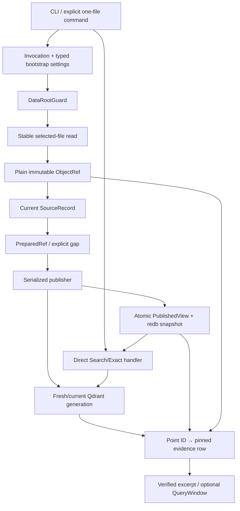
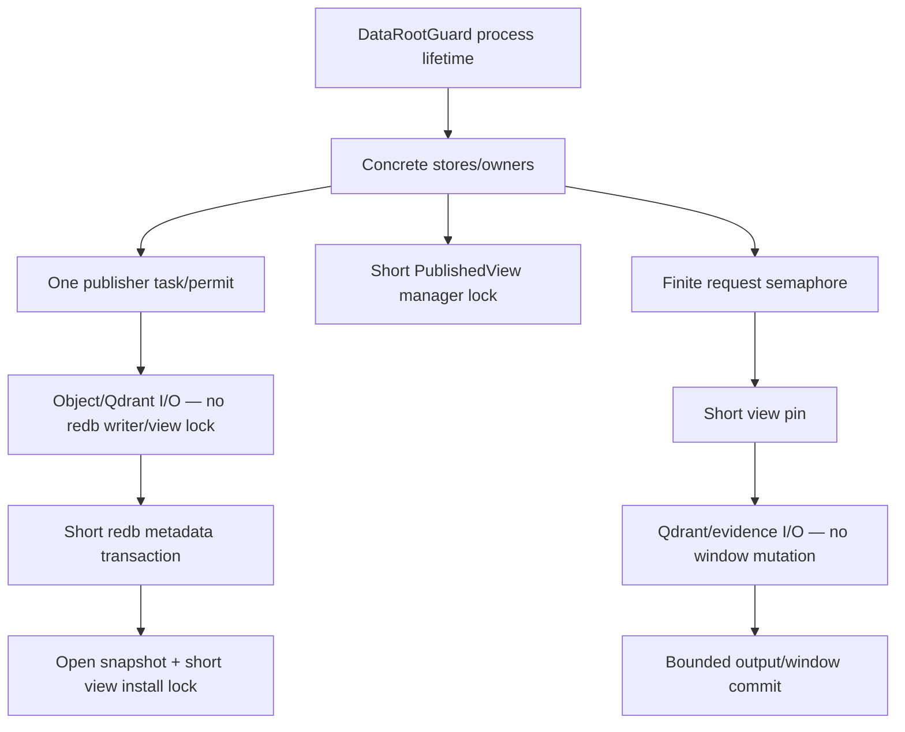

# Current implementation dependency graph

The target is one application with concrete owners. Package boundaries may shrink; this graph records data,
effect and lifetime dependencies, not permanent crate topology.

## Delivery spine

1. **Foundation:** invocation/root/plain settings and one `DataRootGuard`.
2. **Walking skeleton:** one explicit file through the full graph to one one-shot CLI result.
3. **Convergence:** restart, selected-root inventory, lost-wakeup recovery, incremental publication and
   rebuild/compaction.
4. **Exact/session:** literal Exact and one live session/`QueryWindow`.
5. **Maintenance/depth:** stopped-root maintenance and selected optional capabilities.

The first product proof deliberately omits watcher, encryption, broad inventory, paging and physical cleanup but
uses the final owners and values.

## Ownership rules

- Retained immutable objects are the source of evidence.
- Redb owns compact current/published state and real read snapshots.
- Qdrant is derived retrieval state.
- Publication is the only Qdrant mutation/current-view/retired-generation owner.
- Query pins one `PublishedView` and has no durable operation journal.
- Configuration fields appear only with a real consumer.
- Plain storage is baseline; #598 encrypted storage is optional.
- New Qdrant points are explicit `insert_only`; closures are fixed non-creating updates.
- Individual points are not physically deleted; cleanup deletes only whole never-reused retired generations.
- Optional adapters enrich the same path and never create a parallel application.

## Lifetime and lock graph

Required order:

- root guard surrounds store lifetime but is not reacquired per request;
- no redb writer or view-manager lock spans Qdrant/object/process I/O;
- no query-window mutation borrow spans retrieval/evidence I/O;
- view installation follows metadata commit; another publication waits until install/recovery resolves;
- last view drop only wakes cleanup; deletion is never performed under the view lock;
- retired-generation cleanup runs only when no publication can target the generation and no guard uses it.

A reverse lock path is a design defect. Remove or adapt the old API rather than preserve the cycle.

## Interface rule

Use concrete owner methods. Add a narrow consumer-owned trait only when multiple real implementations exist.
Test fakes remain private. Vendor/redb/OS types stay inside adapters.

See the [implementation spine](../implementation/README.md#delivery-sequence),
[lock order](../implementation/README.md#lifetime-and-lock-order), affected owner recipe and #264. Every code cut
connects a real producer to a real consumer and removes the displaced mechanism or names one immediately bounded
follow-up.
