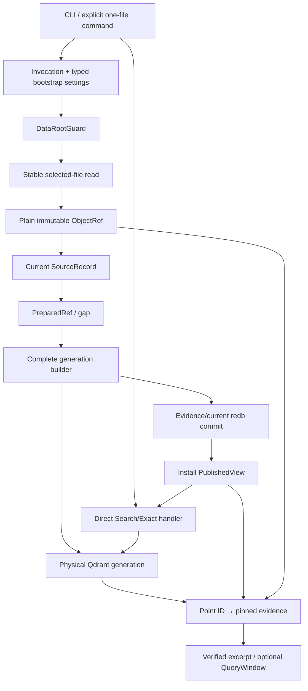
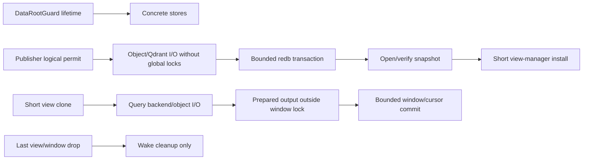

# Current implementation dependency graph

The target is one application with concrete owners. Package boundaries may shrink; this graph records data/effect
dependencies rather than permanent crate topology.

## Progressive path

### Foundation

One invocation, small root/plain settings, manifest-last empty-root initialization, one process-lifetime guard and
factual status. No source/Qdrant/query framework.

### Walking skeleton

Follow the entire graph for one explicit file, plain storage, one fresh physical collection and one one-shot
Search. It uses final owners and persists reopen-capable references.

### Fresh-generation convergence

Startup/explicit/periodic inventory compares desired selected state with published inventory. Any real difference
builds a complete fresh never-reused generation and matching evidence snapshot, then commits/installs the new
view. The visible collection is immutable. Old views keep old physical collections.

This stage supplies correctness, restart and old-view behavior before cross-revision point continuity or
intra-generation mutation.

### Measured incrementality

Only when full-rebuild measurements justify it, add stable occurrence reuse, insert-only additions, one fixed
non-creating closure and compaction. A fresh-generation profile remains a valid shipped mode; incrementality is
not architecture theatre.

## Ownership rules

- retained objects are source evidence;
- redb owns compact current/published state and real snapshots;
- Qdrant is replaceable derived retrieval state, but it is the only selected backend;
- publication is the only Qdrant mutation/current-view owner;
- `PublishedView` names an exact physical collection, never a Qdrant alias;
- a complete build/readback and metadata commit precede view installation;
- query pins one view and has no durable journal;
- configuration fields appear only with a real consumer;
- plain storage is baseline; #598 encryption is optional;
- watcher events only dirty a root; inventory establishes selected state;
- optional adapters enrich the same path and never create a parallel application.

## Lifetime/lock edges

No redb writer, view-manager mutex or QueryWindow mutation borrow spans object/Qdrant/process/model I/O. Cleanup
never runs inline from a guard destructor.

## Explicit non-edges

- no Qdrant alias → ELIOT visibility authority;
- no Tantivy/Zoekt fallback → backend abstraction;
- no watcher → source truth;
- no encrypted profile → plain baseline dependency;
- no point-identity continuity → fresh-generation correctness prerequisite;
- no release qualification → first product result prerequisite.

Use concrete methods. Add a narrow consumer-owned trait only for multiple real current implementations; private
test fakes do not justify a production interface.

See the [delivery sequence](../implementation/README.md#delivery-sequence), affected owner recipe and #264. Every
cut connects a real producer to a real consumer and removes the displaced route.