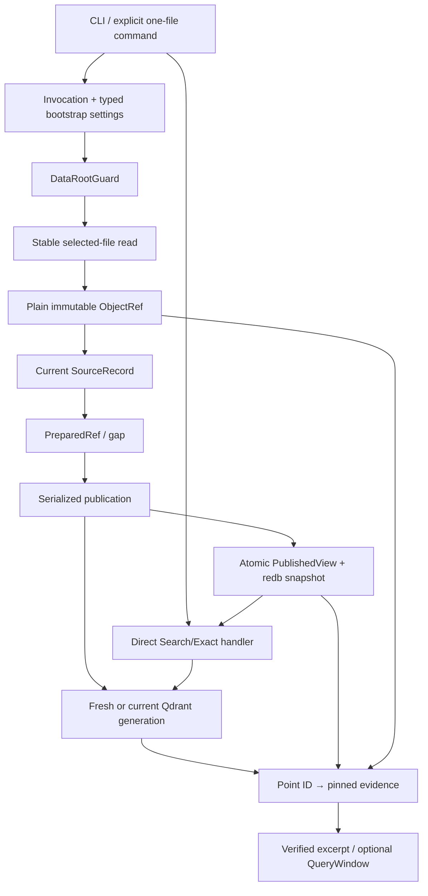

# Current implementation dependency graph

The target is one application with concrete owners. Package boundaries may shrink; the graph records data and
effect dependencies, not permanent crate topology.

## First walking skeleton

The first integration cut follows the whole graph for one explicit local file, plain storage, one fresh
generation and one one-shot Search result. It deliberately omits watcher, broad inventory, encryption, paging and
cleanup, but it uses the final owners and types.

After that proof:

1. add startup/explicit/periodic reconciliation and incremental publication;
2. add Exact and live-session windows;
3. add rebuild/compaction and whole-generation cleanup;
4. add stopped-root maintenance and optional product depth.

This order avoids horizontal packages that cannot be exercised.

## Ownership rules

- retained objects are the source of evidence;
- redb owns compact current/published state and real read snapshots;
- Qdrant is derived retrieval state;
- publication is the only Qdrant mutation/current-view owner;
- query pins one `PublishedView` and has no durable journal;
- configuration fields appear only with a real consumer;
- plain storage is baseline; #598 encrypted storage is optional;
- individual Qdrant points are not physically deleted in the baseline;
- optional adapters enrich the same path and never create a parallel application.

Use concrete methods. Add a narrow consumer-owned trait only for multiple real current implementations. Test
fakes remain private.

See the [delivery sequence](../implementation/README.md#delivery-sequence), the affected owner recipe and #264.
Every cut connects a real producer to a real consumer and removes the displaced mechanism.
