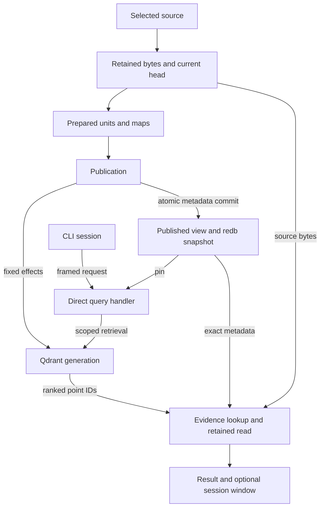

# Current implementation dependency graph

The target is one application with concrete owners. This path is not connected in the current binary.
Package boundaries may shrink or disappear; the graph records data dependencies, not a permanent crate topology
or a recovery algorithm. The [owner recipes](../implementation/README.md#owners) define each operation.



The query owns scope, deadline/cancellation and finite limits. Exact uses the retained reader directly; it
does not take its domain from ranked nominations. One client owns child stdio. Bodies and unfinished effect
pages stay in the shared object store; compact current/published metadata stays in redb. A view owns the real
read snapshot, not a manifest copied into a second index. Qdrant does not become the evidence store.

## Ownership rules

- Source bytes have one immutable object owner. redb stores references, not duplicate bodies.
- Qdrant is a derived retrieval index. It never owns source evidence or durable publication recovery.
- `PublishedView` is the immutable query snapshot. Source registry/current control state is not a second query
  snapshot.
- Publication is the only Qdrant mutation/recovery/current-view owner.
- Query reads have no durable operation journal.
- Optional restricted clients, model providers, overlays, connectors, orientation and comparison exist only
  after a real consumer/implementation is selected. They narrow or enrich this graph; they do not create a
  parallel application.

## Interfaces

Use concrete owner methods. A narrow trait is local to a consumer only when multiple real implementations
exist. There is no global `search-ports` registry, service locator, effect bus or conformance catalogue.

```text
one implementation        → concrete type/method
multiple current adapters → smallest consumer-owned trait
test fake only             → private/local fake, not public product architecture
```

Cross-package shared types live in `search-contracts` only when at least two real current owners use them.
Vendor/redb/OS types stay private to their adapter where useful.

## Cutover order

The [implementation order](../implementation/README.md#order-and-evidence) and
[#352](https://github.com/UnknownAlienHuman/eliot-search/issues/352) connect source/preparation, publication,
query and the local client. Implement rebuild/cleanup with publication's real recovery state; they are not a
separate legacy rebuild platform. Product depth follows actual producers, and independent cuts can proceed
without waiting for every earlier box. The [caller map](../../bins/eliot-searchd/FUNCTIONS.md#query-publication-and-rebuild-boundaries)
identifies the disconnected owners being replaced.

Every slice connects the real producer and consumer and removes the replaced mechanism. A trait, adapter,
receipt, capability, issue or test fixture is not delivery.

The former Architecture 8.4 graph at commit `c8e38b6fc9829f1cd38070773b1b3e5b21de18ad`
is historical evidence only. It cannot restore the global port catalogue, wave dependencies or pre-release
compatibility requirements.
